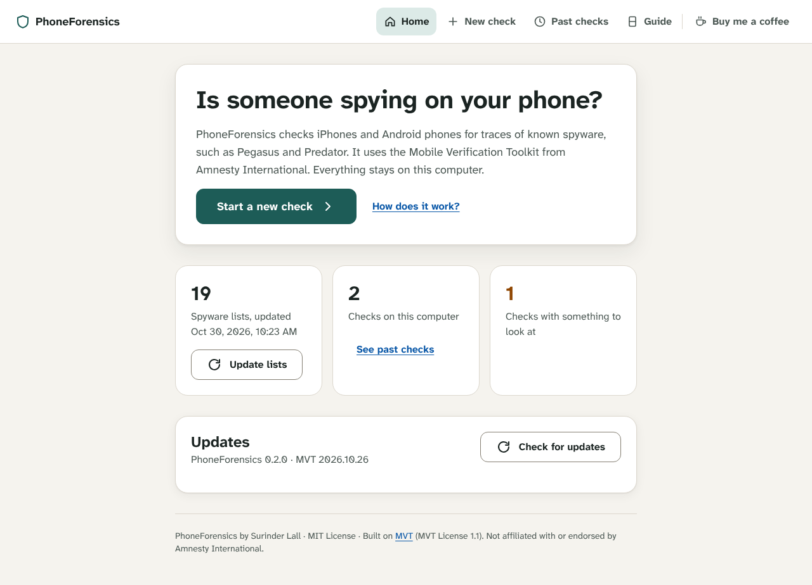
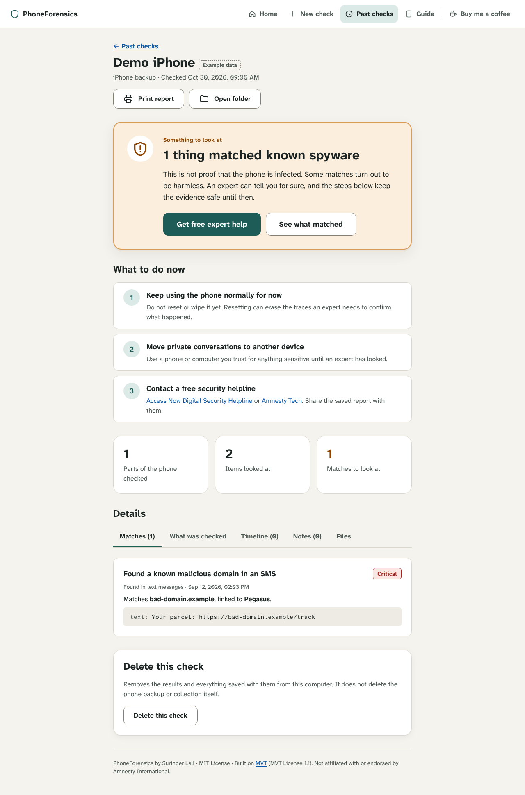

# PhoneForensics

[](https://github.com/stoicops/phoneforensics/actions/workflows/ci.yml)
[](LICENSE)

**A point-and-click app for checking phones for spyware. No command line needed.**

Created by **Surinder Lall**.

PhoneForensics puts a calm, guided interface on Amnesty International's
[Mobile Verification Toolkit (MVT)](https://github.com/mvt-project/mvt), so people who are not technical can check an
iPhone or Android phone for traces of known spyware such as Pegasus and Predator.

- **Step-by-step wizard:** pick the phone, follow plain-language instructions to save its data, click *Start check*.
- **Finds iPhone backups by itself** and says whether they are encrypted.
- **Live progress** in plain language, with the technical log tucked away for experts.
- **A clear answer** ("No known spyware found" or "Something to look at") with next steps and links to free helplines.
- **History, printable reports** and the raw MVT files to share with an analyst.
- **One-click updates** for the app, for MVT and for the spyware lists.
- **Private by design.** It runs only on `127.0.0.1`, uploads nothing, and makes no third-party requests (even the fonts are bundled).
- **Accessible.** WCAG 2.2 AA checked with axe in light and dark mode, full keyboard support, works at phone width.




---

## For everyone: getting started

1. Install **Python 3.10 or newer** from <https://www.python.org/downloads/>. On Windows, tick **"Add python.exe to PATH"**.
2. Download PhoneForensics: green **Code** button → **Download ZIP**, then unzip it.
3. Double-click the launcher:
   - **Windows:** `Start PhoneForensics (Windows).bat`
   - **Mac:** `Start PhoneForensics (Mac).command` (the first time: right-click → **Open**)
   - **Linux:** `./start-linux.sh`

The first start sets everything up (a few minutes). Your browser then opens PhoneForensics. Keep the small black
window open while you use it; close it to quit.

**Saving data from the phone:** the app's **Guide** tab has step-by-step instructions for iPhone (Mac and Windows),
AndroidQF and Android bug reports. The same guides are in [docs/SAVING-PHONE-DATA.md](docs/SAVING-PHONE-DATA.md).

**Updating:** click **Check for updates** on the Home screen.

- Installed with `git clone`: **Update now** gets the latest version, updates MVT and restarts.
- Downloaded as a ZIP: the app tells you when a new [release](https://github.com/stoicops/phoneforensics/releases) is out and links to it. **Update now** still updates MVT.
- Spyware lists are updated separately with **Update lists**. Do this often.

### Acceptable use and consent

PhoneForensics is for checking **your own phone**, or a phone whose user has freely agreed: for example, a
digital-security helper working with a journalist. It is not for monitoring partners, employees or anyone else.

This is a legal condition, not only a guideline. The [MVT License](https://license.mvt.re/1.1/) (§3.0) allows use
only if the **person whose data is on the phone** explicitly agrees, without any pressure, after being told what the
check involves, its privacy implications, and how long the results are kept and how they are deleted. Before
every check the app shows exactly that information and asks you to confirm. It records the confirmation with the
check, and **Delete this check** removes the results when they are no longer needed. See
[NOTICE.md](NOTICE.md#consent-is-a-condition-of-use-mvt-license-30).

A clean result is not a guarantee: MVT can only recognise spyware for which public indicators exist. If you are
at risk, contact [Access Now's Digital Security Helpline](https://www.accessnow.org/help/) or
[Amnesty International's Security Lab](https://securitylab.amnesty.org/get-help/).

---

## For developers

### Tech stack

| Layer | Choice |
|---|---|
| Forensics engine | [MVT](https://github.com/mvt-project/mvt), run as a subprocess |
| Server | Python 3.10+, Flask (routes), Waitress (production WSGI server) |
| Front end | Native ES modules (no build step), JSDoc types checked by TypeScript (`strict`) |
| Design | Tokens and components from `design/tokens.json` (Atkinson Hyperlegible, light and dark) |
| Quality | Ruff (lint and format), mypy `--strict`, Biome, pytest, Node test runner, Playwright and axe-core |
| Supply chain | `requirements*.lock` (uv, universal), `package-lock.json`, pip-audit, npm audit |

### Prerequisites

- Python 3.10+
- Node.js 20+ (development only: linting, type checking and browser tests)
- `make` (optional; every target is a short command you can run by hand)

### Setup and common tasks

```bash
make setup        # .venv + locked dependencies + npm packages + Playwright Chromium
make dev          # run on http://127.0.0.1:8765 with debug logging (no browser pop-up)
make start        # run like an end user
make lint         # ruff + biome
make typecheck    # mypy --strict + tsc --checkJs
make test         # pytest (85% coverage gate) + JS unit tests
make test-e2e     # browser tests: every screen, light/dark, phone width, axe, keyboard, a real MVT scan
make check        # everything CI runs
make build        # wheel + sdist into dist/
make lock         # refresh lockfiles after editing dependencies in pyproject.toml
```

Optional: `pre-commit install` runs ruff, Biome, mypy and basic hygiene checks on every commit.

### Configuration

All settings are optional environment variables; see [.env.example](.env.example).

| Variable | Default | Purpose |
|---|---|---|
| `PHONEFORENSICS_HOME` | `~/PhoneForensics` | Where checks and results are saved |
| `PHONEFORENSICS_PORT` | `8765` | Local port (always bound to `127.0.0.1`) |
| `PHONEFORENSICS_SUPPORT_URL` | buymeacoffee.com/surinder | The "Buy me a coffee" link (https only; empty hides it) |
| `PHONEFORENSICS_LOG_LEVEL` | `INFO` | Structured JSON logs to the console |

### Project structure

```
src/phoneforensics/
  cli.py          entry point: argument parsing, logging, Waitress
  server.py       HTTP routes (thin: validation and wiring)
  security.py     host/origin/JSON guards and security headers
  jobs.py         background jobs and output streaming
  mvt.py          how MVT is invoked (pure command builders)
  results.py      MVT output → summary; saved checks
  ios.py          finding and describing iPhone backups
  updates.py      app and MVT update checks and installs
  config.py       constants and environment settings
  logs.py         JSON log formatter
  static/
    index.html, tokens.css, components.css, styles.css, fonts/
    js/main.js        router (lazy-loads views) and global error handling
    js/api.js         typed API client
    js/html.js        escape-by-default HTML templating
    js/content.js     guides, evidence types and next steps (the words)
    js/views/*.js     one module per screen
tests/python      unit and API tests (with a fake MVT)
tests/js          front-end unit tests
tests/e2e         browser tests against the real server
docs/             user guide (generated), screenshots, design decisions
```

### Supported evidence

| Phone | Evidence | MVT command |
|---|---|---|
| iPhone | Finder / iTunes / Apple Devices backup | `mvt-ios decrypt-backup` (if encrypted) + `check-backup` |
| iPhone | Full file-system dump | `mvt-ios check-fs` |
| Android | AndroidQF collection | `mvt-android check-androidqf` |
| Android | Bug report `.zip` | `mvt-android check-bugreport` |
| Android | `adb backup` file (`.ab`) | `mvt-android check-backup` |

### Security notes

The server only listens on `127.0.0.1` and defends against other websites reaching it: Host checks (DNS
rebinding), exact-Origin and JSON-only writes (CSRF), and a strict Content Security Policy. All dynamic HTML goes
through an escape-by-default template. iPhone backup passwords go to MVT through an environment variable. MVT's
Android commands only take the password as an argument, so it is briefly visible to other accounts on the same
computer. See [docs/DECISIONS.md](docs/DECISIONS.md) for the reasoning behind these and other choices.

Found a vulnerability? Please open a private
[security advisory](https://github.com/stoicops/phoneforensics/security/advisories/new) rather than a public issue.

### Releasing

1. Bump `__version__` in `src/phoneforensics/__init__.py` and `version` in `pyproject.toml`.
2. Run `make check`.
3. Tag `vX.Y.Z` and publish a GitHub release. Users who installed from a ZIP are notified in the app.

### Editing the user guide

The guides live in `src/phoneforensics/static/js/content.js`. After changing them, run `npm run docs` to
regenerate `docs/SAVING-PHONE-DATA.md`; a test fails if you forget.

---

## Support

If PhoneForensics helps you, you can support it at [buymeacoffee.com/surinder](https://buymeacoffee.com/surinder).

## License

- **PhoneForensics** is © 2026 Surinder Lall and released under the [MIT License](LICENSE).
- **MVT** is not part of this repository. It is installed separately and governed by the
  [MVT License 1.1](LICENSES/MVT-License-1.1.txt) (source: [mvt-project/mvt](https://github.com/mvt-project/mvt)).
  PhoneForensics is a "Larger Work" under that license, and its consent condition (§3.0) applies to every use of
  PhoneForensics to analyse a device.
- **Fonts** are under the [SIL Open Font License 1.1](LICENSES/OFL-1.1.txt).
- Planning to bundle MVT into an installer? Read
  [what the MVT License requires](NOTICE.md#if-you-redistribute-phoneforensics-with-mvt-included) first.

PhoneForensics is not affiliated with or endorsed by Amnesty International or the MVT project. It is provided
without warranty; MVT is provided "as is" by its contributors (MVT License §6–7). [NOTICE.md](NOTICE.md) has the
full details. It is not legal advice.
