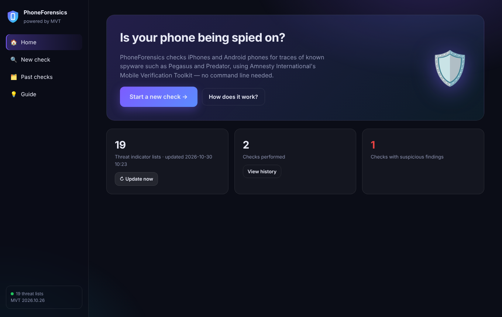
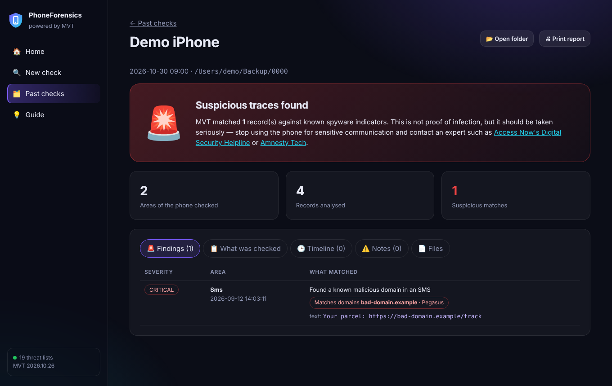

# PhoneForensics

**A point-and-click app for checking phones for spyware — no command line required.**

PhoneForensics wraps Amnesty International's [Mobile Verification Toolkit (MVT)](https://github.com/mvt-project/mvt)
in a friendly, guided interface so that non-technical people can check an iPhone or Android phone for traces
of known spyware such as Pegasus and Predator.

- 🧭 **Step-by-step wizard** — pick the phone type, follow plain-language instructions to get the data, choose it, click *Start*.
- 🔎 **Finds iPhone backups automatically** and tells you whether they're encrypted.
- 📡 **Live progress** while MVT runs, with technical logs tucked away for experts.
- 🚦 **Clear verdict** — "No known spyware found" or "Suspicious traces found", with what matched and where to get help.
- 🗂️ **History of past checks**, printable reports, and the raw MVT output to share with an analyst.
- ⬇️ **One-click threat-indicator updates.**
- 🔒 **Everything stays on your computer.** The app only listens on `127.0.0.1`; nothing is uploaded.




## Getting started (non-technical)

1. Install **Python 3.10+** from <https://www.python.org/downloads/> (on Windows, tick *"Add Python to PATH"*).
2. Download this project (green **Code** button → *Download ZIP*) and unzip it.
3. Double-click the launcher:
   - **Windows:** `Start PhoneForensics (Windows).bat`
   - **Mac:** `Start PhoneForensics (Mac).command` (first time: right-click → *Open*)
   - **Linux:** `./start-linux.sh`

The first launch installs everything it needs (a few minutes). Your browser then opens PhoneForensics.
Keep the small black window open while you use the app; close it to quit.

## Getting started (technical)

```bash
pip install -e .
phoneforensics            # or: python -m phoneforensics --port 8765 --no-browser
```

Results are saved to `~/PhoneForensics/cases/` (override with the `PHONEFORENSICS_HOME` environment variable).

## Supported evidence

| Phone   | Evidence                              | MVT command                    |
|---------|---------------------------------------|--------------------------------|
| iPhone  | iTunes / Finder backup (encrypted or not) | `mvt-ios decrypt-backup` + `check-backup` |
| iPhone  | Full filesystem dump                  | `mvt-ios check-fs`             |
| Android | AndroidQF collection                  | `mvt-android check-androidqf`  |
| Android | Bug report zip                        | `mvt-android check-bugreport`  |
| Android | `adb backup` file (.ab)               | `mvt-android check-backup`     |

## How it works

`phoneforensics/app.py` is a small Flask server that runs the MVT command-line tools as subprocesses,
streams their output to the browser (Server-Sent Events), and summarises MVT's `alerts.json`, per-module
JSON files and alert timeline into a readable report. The interface is plain HTML/CSS/JS in
`phoneforensics/static/` — no build step.

## Important

A clean result is not a guarantee that a phone is safe: MVT can only recognise spyware for which public
indicators exist. If you are at risk, contact [Access Now's Digital Security Helpline](https://www.accessnow.org/help/)
or [Amnesty International's Security Lab](https://securitylab.amnesty.org/get-help/).

MVT is developed by Amnesty International and released under its own [MVT License](https://github.com/mvt-project/mvt/blob/main/LICENSE);
please review its terms before redistributing.
